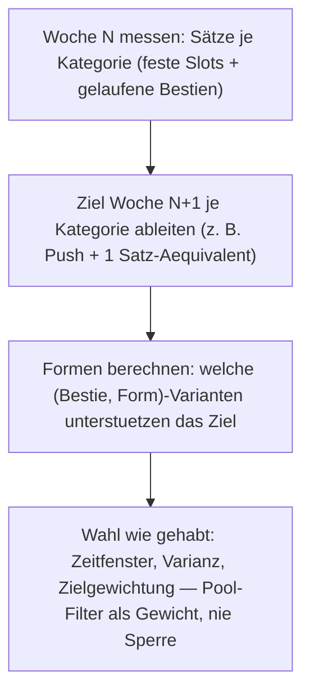

# Bestien-Progression — die Woche zählt, der Pool dosiert

**„Die Bestie folgt der Bilanz, nicht der Laune."**

## Leitbild

Friedrichs Befund (10.11.2026): Alchemist (im Gespräch „Magician"), King und Pilgrim fühlen sich schwach und unprogressiv an — alle drei tragen Bestien, aber ihre Bestien sind Varianz- und Zeitinstrumente, keine Fortschrittsnerven. Die Idee aus dem Gespräch: Woche 1 zählt alle „Sets" der Pushing-Übungen, multipliziert mit der Schwere der Übung; Woche 2 erzeugt daraus eine Bestienauswahl, die bei Pushing ein Set pro Woche mehr oder mehr Schwierigkeit bringt.

Zwei Präzisierungen von Friedrich, die das Konzept tragen:

1. **„Die Dosierung erfolgt nicht an der einzelnen Bestie"** — gesucht wird ein Bestienpool für die Folgewoche, der z. B. „Push plus 1" erfüllt. Die einzelne Bestie bleibt unangetastet; die Auswahl aus dem Bestand ist das Dosierungsinstrument.
2. **Reißbrett-Runde 2: Bestien stehen fest. An den Reps einer Runde ändert sich nichts. Die einzigen Dosisformen sind Partials (z. B. 3 von 5 Runden), Doubles und Triples.** Keine neuen Bestien, keine Stufen-Kuration — die Progression kommt ausschließlich aus Form und Auswahl.

Damit ist die frühere Idee der Stufen-Kuration (20/25/30 Thrusters als separate Einträge) vom Tisch; die Feinheit, die die Stufen liefern sollten, kommen jetzt die Partials: Die Runde ist die kleinste Dosierungswährung, und Bestien mit 4–7 Runden geben ein ausreichend feines Raster.

## Formenlehre

- **voll**: die Bestie wie kuratiert (Grundform).
- **Partial k/R**: nur k der Runden (Friedrichs Beispiel: 3 von 5). Sets und Zeit skalieren auf k/R.
- **Doppel**: dieselbe Bestie zweimal (Sets ×2, Zeit ×2).
- **Triple**: dreimal (Sets ×3, Zeit ×3).

Zähleinheit „Set" (Friedrichs Entscheidung, Runde 3): **App-Zählung mit BEAST_FACTOR 0,5 — eine Übung einer Runde zählt als halber Satz in ihrer Kategorie.** Begründung: Bestienrunden sind keine Arbeitsätze bis RIR 1–3, sondern zeitgetriebene Cluster, die manchmal weit davor stoppen — konservativ halbzählen. Das ist zugleich die Skala von volume.ts (Volumen-Karte, weeklyVolume, balanceScore): Dosissteuerung und Anzeige rechnen identisch. Laufen, Rudern, Pausen zählen nicht — sie laufen über die Zeitfenster der Klassen weiter. Konsequenz: Zielgrößen werden in App-Sätzen formuliert („8" heißt nie mehr 16 Übungsrunden, sondern 8 halbe Sätze); siehe Reißbrett-Zweitrunde unten.

## Kategorien-Grammatik

Jede Bestienübung zählt genau EINER Kategorie, abgeleitet aus der Muskel-Zuordnung des Katalogs (musclesOf, dieselbe Quelle wie beastSets):

- **push** = Brust, Trizeps, Schultern-im-Press
- **pull** = Rücken, Bizeps
- **legs** = Quadrizeps, Gesäß, Beinbeuger, Waden
- **core** = Rumpf, Unterarme (Hangs zählen hier, wie die App sie in CORE_RX führt)

Kurierte Metcon-Entscheidungen (offen legbar, Änderung ändert die Zahlen, nicht die Methode): Thrusters und Burpee-Familie = push, Snatch-/Swing-/Deadlift-Familie = legs, Supermen/Hang-Arbeit = core, Face-Pull-/Fly-/Row-Schulterarbeit = pull.

## Reißbrett-Rechnung: 3 Bestien, 8/8/8/8 (10.11.2026, über den echten Bestand von 86 Bestien)

**Vorgabe:** Wähle 3 verschiedene Bestien, je eine Form; die Summen je Kategorie sollen das Ziel erreichen.

**Bestandsdeckung** (wie viele Bestien liefern überhaupt Sets in der Kategorie):

| push | pull | legs | core |
|---|---|---|---|
| 54 | 40 | 54 | 48 |

**Pull ist der Flaschenhals**: 46 der 86 Bestien haben keinen einzigen Pull-Anteil. Stärkste Pull-Spender (volle Form): Alberich 10, Roch 10, Sirrusch 10, Peri 8. Jede Lösung braucht mindestens eine pull-tragende Bestie.

**Lösungsraum** (Tripel aus 3 verschiedenen Bestien, alle vier Kategorien ≥ 8):

| Einschränkung | Anzahl Lösungen |
|---|---|
| alle Formen erlaubt (voll, Partial, Doppel, Triple) | 1.394.894 |
| nur volle Bestien, keine einzige Form | 440 |
| nur handfeste Formen (halbe Bestie bis voll, ohne Doppel/Triple) | 26.874 |
| davon unter 45 Min Bestienzeit/Woche | 64.606 (alle Formen) |
| exakt 8/8/8/8 (alle Formen) | 39 |
| exakt 8/8/8/8 (handfeste Formen) | 273 |

**Beispielauswahlen:**

- **Aufhocker + Asag + Peri** (alle voll): exakt 8/8/8/8 in 36 Minuten — die Aufgabe ist ohne jede Form lösbar.
- **Heinzelmann + Wila + Div** (2/4 · voll · 2/4): exakt 8/8/8/8 in 19 Minuten — Partials dosieren dieselbe Menge in halber Zeit.
- Volle-Bestien-Lösungen: Spanne 19–119 Minuten, Median 43.

**Design-Schlüsse aus der Rechnung:**

1. Der Raum ist reichhaltig genug — Varianz über viele Wochen bleibt erfüllbar (440 Wochen-Wahlen allein mit vollen Bestien).
2. Das Ziel sollte **„≥ 8 mit minimalem Überhang"** heißen, nicht „= 8": die Rundendiskretisierung erzeugt fast immer Überhang; Exakt-Treffer sind Zufall (39).
3. **Zeit ist der zweite Begrenzer neben Pull**: Doppel und Triple blähen die Wochenzeit auf (Doppeln einer 14-min-Bestie = 28 Min, sprengt plague/bestie-Fenster); der Großteil der 1,4 Mio Lösungen ist zeitlich unbrauchbar. Formen brauchen eine Fenster-Regel.
4. Extreme Partials („1 von 7 Runden") sind formal gültig, praktisch Mini-Finisher — die Untergrenze der Partial-Stufen bestimmt die Dosier-Feinheit und den Exakt-Anteil (273 vs. 39).
5. Die Pull-Lücke ist strukturell: Hantiert die Woche an pull-tragenden Familien vorbei (Varianzregel!), kippt das Ziel. Der Pool-Filter muss pull besonders im Blick behalten.

## Reißbrett-Zweitrunde: App-Skala 0,5 und Boundary +15 % (10.11.2026, Friedrichs Entscheidungen)

Mit der halben Zählung verschieben sich die Zielgrößen, und die Rechnung zeigt: **„8 App-Sätze je Kategorie" ist mit 3 Bestien praktisch unerreichbar** — keine einzige Lösung nur mit vollen Bestien (Bestien liefern schlicht zu wenig je Kategorie); selbst mit allen Formen bleiben 2.916 Lösungen, deren schnellste ein Triple braucht. Das natürliche Wochenziel für 3 Bestien ist die halbe Größe.

| Ziel je Kategorie | Intervall (+15 %) | Lösungen | nur volle Bestien | exakt am Ziel | schnellste Lösung |
|---|---|---|---|---|---|
| 4 App-Sätze (8 Runden) | [4,0 · 4,6] | 6.499 | 137 | 1.086 | Sirrusch 1/5 + Wila + Wilder Mann 3/5 — 4/4/4,5/4,5 in 17 Min |
| 8 App-Sätze (16 Runden) | [8,0 · 9,2] | 2.916 | 0 | 198 | Wila Triple + Huma + Div 2/4 — 9/9/8/9 in 35 Min |

- **Fixpunkt bleibt**: Aufhocker + Asag + Peri (alle voll) = exakt 8 Übungsrunden je Kategorie = exakt 4 App-Sätze je Kategorie, 36 Minuten — die Reißbrett-Aufgabe der ersten Runde ist auf App-Skala das 4-er-Ziel.
- **Zielgrößen koppeln an die Bestienzahl der Woche** (Faustzahl: ~1,3 App-Sätze je Kategorie je Bestien-Slot): 3 Bestien → 4, eine Woche mit bonus-Bestie oder freier Jagd → höher. Fixe Werte je Orden definieren, nicht global.

**Entscheidungen der dritten Runde (alle geschlossen):**

1. **Zählskala**: 0,5 (App) — siehe Formenlehre.
2. **Partial-Untergrenze**: keine — jede Rundenzahl ab 1 ist eine zulässige Form („1/7 wäre absolut okay", Friedrich).
3. **Zielkriterium**: Ziel mit Überhang, Boundary +15 % — akzeptables Intervall [Ziel · Ziel × 1,15]; die Zahlen oben zeigen, dass das Intervall mit feinen Partials gut füllbar ist.
4. **Fenster-Regel**: Klassenfenster je Tag, keine Wochen-Obergrenze. Die 45-Min-Wochengrenze war Concurrent-Training-Schutz; für conditioning-primary-Orden (GPP: King, Gladiator, Pugilist) ist die Bestienarbeit der Hauptreiz, keine Grenze dort. Muskelerhalt wird nicht über eine Zeitgrenze gesichert, sondern über die Kategorienlast selbst — die misst die Dosis, und der Pool-Filter steuert Lücken an. In kraft-/hypertrophie-lastigen Orden bleibt die Bestienzeit ohnehin durch die Rollenfenster begrenzt; dort höchstens ein Warnhinweis statt Grenze. Formen wirken auf die effektiven Minuten: ein Doppel einer 14-Min-Bestie (28 Min) muss ins Fenster des Tages passen, sonst ist es kein Kandidat — der bestehende Zeitfenster-Check bleibt unverändert, er prüft nur die formeffektive Dauer.
5. **Zielführung** (jetzt geklärt): Zielvektor je Woche = fixe Grundwerte je Kategorie (an Bestienzahl gekoppelt, s. o.) + Progression durch Anhebung (+0,5 App-Sätze je Kategorie je Woche bis zum Richtwert) + Lückenkorrektur als Priorisierung im Pool-Filtergewicht (Kategorie mit Lücke bekommt Vorrang — niemals eine Sperre). Mengenprogression über das Ziel, Schwere-Progression läuft weiter über die bestehende Bestzeiten-Klassenlogik; Lastbestien haben suggestLoad ohnehin.
6. **Deload**: Zielskalierung statt Pause — die Dosisziele der Woche werden mit dem Deloadfaktor (~0,5, Systemgröße aus deloadShape) multipliziert, die Formen machen die reduzierte Dosis dosierbar (statt voll → 2/4-Runden-Partials). Deloadwoche: Ziel 2 App-Sätze je Kategorie — mit Partials trivial erreichbar. Testwoche: Dosisziele aus; die Benchmark-Bestie läuft unverändert nach ihren eigenen Regeln.

## Reißbrett-Runde 4: Dosis-Treppe am King (Ordensbeispiel, 10.11.2026)

Friedrichs Beispiel: erfahrener Athlet, King soll mit Kraftübungen und Bestien zusammen bieten — Woche 1 ~12 Arbeitssätze je Muskelgruppe, Woche 2 13–14, Woche 3 16–18, Woche 4 bei 16–18 bleiben, aber in push/pull werden die Übungen anspruchsvoller (anteilig Archer Pushups statt normale Pushups, anteilig Clapping Pullups statt normale Pullups). „Sanfte Progression: blockweise Sets erhöhen, dann sukzessive Übungsschwierigkeit oder bei loaded beasts die vorgeschlagene Last. Softer Onramp."

**Befund: geht — die Treppe ist eine doseGoal-Periodisierung über die Blockwochen, und die Qualitätsstufe ist SELEKTIV über den Pool abbildbar, ohne eine einzige Bestie anzufassen.** Kings Basislast (feste Slots, volle Arbeitssätze) und Bestienfenster, nachgerechnet:

| Woche | Basis push | Basis pull | Basis legs | Basis core | Bestien-Slots |
|---|---|---|---|---|---|
| week_3 (3 Tage) | 9 | 0 (!) | 3 | 5 | 1 × ungeheuer (≤21 Min) |
| week_4 (4 Tage) | 9 | 4 (Table Row) | 10 | 5 | 2 × (ungeheuer, bestie ≤14) |
| week_4 + bonus | 9 | 4 | 10 | 5 | 3 × (ungeheuer, bestie, ungeheuer) |

Maximale Bestienbeiträge je Slot: push 7 / pull 5 / legs 10,5 / core 5 App-Sätze (ungeheuer-Fenster). Drei Konsequenzen aus der Rechnung:

1. **Der Zielvektor muss asymmetrisch sein**: Kings feste Slots liefern kaum pull (week_3: null; week_4: 4 über Table Row), und der Pool-Anteil pull-tragender Bestien ist der Flaschenhals — pull 13 aus drei Slots ist knapp das Maximum. Die Treppe wird je Kategorie aus Basislast + Poolkapazität abgeleitet und in pull gekappt (z. B. push 12/14/17/17, pull 9/11/13/13, legs 12/14/17/17, core 12/14/16/16); ein symmetrisches „12/13,5/17/17 je Kategorie" ignoriert die Poolstruktur. Die Engine kürzt das Ziel auf das Erreichbare und sagt ehrlich warum.
2. **Doppel und Triple passen bei King in kein Fenster** (alle Slots ≤21 Min; ein Doppel einer 17-Min-Bestie = 34 Min). Kings Dosis-Schrauben sind Partials und die Klassenwahl; Doppel/Triple leben nur in Fenstern ab „verfluchte"-Größe (z. B. Conqueror-Reise) — der Pool-Filter rechnet formeffektive Minuten gegen das Fenster, das regelt das von selbst.
3. **Die 3-Tage-Woche senkt die Treppe automatisch**: week_3 hat einen Bestien-Slot und pull-Basis 0 — dort ist keine pull-Treppe abbildbar. Das ist korrekt: Die Alltagslast bestimmt die Wochengröße, das doseGoal skaliert mit der Woche („Alltag ist Trumpf"). Optional als King-Anpassung (Orden-Design, kein Muss): chaos_b (40 Min, reise: Sprints + Swing/Push-Up-Superset + Halo) könnte eine Bestie bekommen — dann hätte auch die kurze Woche zwei Slots.

**Woche 4 — Qualität statt Menge (der elegante Teil):** Der Pool enthält bereits fortgeschrittene push/pull-Übungen in echten Bestien — 35 von 86 Bestien, davon 27 mit pull- und 31 mit push-Anteil. Konkret: **Striga (Archer Pushup, 11 Min, bestie-Fenster)**, **Puck (Clapping Pullups, 14 Min, bestie-Fenster)**, Moosweib und Troll (Commando Pullups), Nachtkrapp, Drude, Lindwurm (Clapping Pushups), eine Muscle-Up-Familie (Alberich, Anzu, Undine, Golem, Roch, Rotkappe, Humbaba, Ghul, Schedu). Woche 4 setzt im poolWeight einen Qualitäts-Bias: Bestien mit fortgeschrittenen Übungen in den Zielkategorien bekommen Gewichtsvorrang. „Anteilig stärker aus Archer statt normalen Pushups" entsteht über die Auswahl, nicht über Substitution — „Bestien stehen fest, Reps bleiben" bleibt vollständig intakt. Erst wenn der Qualitätspool nicht reicht, wäre eine Stufen-Kuratierung (Übungssubstitution innerhalb der Bestie, gleiche Reps — das Analogon zu BANDS.levels) als spätere Dimension denkbar; die Rechnung sagt: reicht nicht nötig.

**Onramp:** Woche 1 geht mit kleinen Partials (Basislast + kleine Bestienbeiträge) sanft los, die Treppe wohnt im doseGoal je Blockwoche, nicht in der Bestie. Bei loaded beasts (Süd-Region) bleibt die Lastvorgabe bei suggestLoad — die existierende Mechanik IST die letzte Stufe der sanften Progression.

## Zwei Schrauben

1. **Selektion** (welche Bestien laufen überhaupt): bestehende Wahl-Mechanik, erweitert um die Lastmessung.
2. **Dosierung** (wie viel kommt in der Folgewoche raus): Ziel je Kategorie ableiten, dann Form und Auswahl aus dem Pool — „ein Bestienpool für die Folgewoche, der Push plus 1 erfüllt".

## Mechanik-Entwurf

### Schraube 1 — die Woche zählen (Lastmessung)

NEU `weekPatternLoad` (Arbeitstitel, neben plannedWeekSets in plan.ts oder eigene Datei beastdose.ts): je Kategorie die Wochenlast = Σ (Sätze × relative Schwere).

- **Pattern-Kategorien** wie oben, Ableitung über musclesOf — keine neuen Metadaten.
- **Relative Schwere**: Epley kg × (1 + Wdh/30) je Übung — dieselbe Formel wie suggestLoad und wie der trendOf-Entwurf im Umbauplan (P6).
- **Geplant vs. erledigt**: Zielbildung aus der GEPLANTEN Folgewoche, Korrektur über erledigte Einheiten (Kurztage senken das Dosisziel — „Alltag ist Trumpf" wertneutral).

### Schraube 2 — der Pool dosiert

- Woche N: Kategorienlast messen. Bestien zählen mit (die Formenlehre macht sie dosierbar: Partial/Doppel/Triple verändern den Beitrag).
- Woche N+1: Ziel je Kategorie; in die engere Wahl kommen (Bestie, Form)-Varianten, deren Profil das Ziel stützt.
- **Rangfolge bleibt**: Zeitfenster > Varianz > Ziel > Pool-Filter. Der Pool-Filter ist ein Gewicht, NIE eine Sperre — greift das Zeitfenster nicht, läuft die beste verfügbare Bestie, der Hinweis bleibt ehrlich.
- **Fenster-Regel für Formen** (entschieden): Klassenfenster je Tag — Partials verkleinern die Bestie (frühere Klasse möglich), Doppel/Triple verlängern sie; der bestehende Zeitfenster-Check prüft die formeffektiven Minuten. Keine Wochen-Obergrenze (Details in der Zweitrunde oben).

## Ordens-Anschlüsse

- **King**: Pilotrolle — Pool-Filter nach Kategorienziel, Bestien in mehreren Rollen pro Woche.
- **Pilgrim**: Ausdauer/Kraft-Balance; seine Bestien sind aerob-lastig, Kategorienlast dort dünn — Zeit-Äquivalent beachten (offene Frage 1).
- **Alchemist („Magician")**: vermutlich reicht die Selektions-Schraube (Bestie holt nach, was der Fokus vermissen lässt).
- **Gladiator (1.21.0)**: Bestien-Finisher hinter den Lasten — profitiert sofort von der Kategorienbalance.

## Restfragen vor dem Bau (alles andere entschieden, siehe Zweitrunde und Vierrunde oben)

1. **Zielvektor-Tabellen je Orden definieren** — King-Pilot: asymmetrische Treppe nach der Vierrunde-Rechnung (pull gekappt an Poolkapazität); Bestätigung der konkreten Zahlen.
2. **Pilgrim**: seine Bestien sind aerob-lastig, Kategorienlast dort dünn — braucht ein Zeit-Äquivalent für aerobe Anteile oder bleibt Pilgrim Mengen-ziel-frei (nur Selektions-Schraube)?
3. **King-Anpassung chaos_b-Bestie** (optional, Orden-Design): der kurzen Woche einen zweiten Bestien-Slot geben?
4. **Bau-Reihenfolge/Version**: erst Mengenlogik (doseGoal-Treppe, Formen, Pool-Filter, Qualitäts-Bias), die Epley-Schwere-Erweiterung ist unabhängig danach schaltbar. Version wegen Umbauplan-Kollision klären.

## Bau-Checkliste (PR-fähig)

1. NEU `src/engine/beastdose.ts`: Kategorien-Mapping (Muskel → push/pull/legs/core, Overrides dokumentieren), `beastCategory` (halbe Sätze je Kategorie je Bestie aus work-String, CARDIO skip — Ableitung wie beastSets mit BEAST_FACTOR 0,5), `formVariants` (voll/Partial-k ab 1 Runde/Doppel/Triple mit halben Sätzen und formeffektiven Minuten), `weekCategoryLoad` (halbe Sätze je Kategorie; feste Slots × Epley als separater Schwere-Term für später), `doseGoal` (Grundwert je Bestienzahl + Progression +0,5/Woche; Deload × Deloadfaktor; Testwoche null), `poolWeight` (Gewicht im +15 %-Intervall, nie Ausschluss; pull-Lücken priorisieren).
2. `plan.ts` pickWith/pickBeast: Formen als Kandidaten (Partials heute schon als shortBeast vorhanden — Doppel/Triple ergänzen), formeffektive Minuten in den bestehenden Klassenfenster-Check je Tag, poolWeight nach Zeitfenster und Varianz.
3. Tests `beastdose.test.ts`: Kategorien-Profile an Hand-Bestien — **Fixpunkt Aufhocker + Asag + Peri (alle voll) = exakt 4/4/4/4 App-Sätze, 36 Min**; Reißbrett-Regressionen (Ziel 4 App-Sätze: 6.499 Lösungen, 137 nur-voll, 1.086 exakt; Ziel 8 App-Sätze: 0 nur-voll); Deload halbiert die Ziele; weekbeasts.test weiter grün (Varianz bleibt vorrangig); Bestien-Dauer-Tests gegen formeffektive Minuten.
4. Help.tsx: Absatz „Bestien: die Woche zählt, der Pool dosiert" — Empfehlung, nie Sperre; Grenzen (keine Wochen-Obergrenze bei conditioning-primary).
5. CHANGELOG + Version: mit Friedrich klären (Umbauplan-Kollision: Gladiator verbrauchte 1.21.0, das der Plan für P1 Zeitstrahl vorsah).

## Grenzen (bewusst nicht)

- Keine neuen Bestien, keine geänderten Reps, keine Stufen-Kuration — Friedrichs Reißbrett-Entscheidung vom 10.11.2026: Dosierung nur über Formen (Partial/Doppel/Triple) und Auswahl.
- Kein Zwang: der Pool-Filter gewichtet, verbannt nie — Empfehlung, nie Sperre.
- Kein RM-Prozent-Kalkül auf Metcons — Zeit und Runden bleiben die Messlatte.
- Der Bestienpool bleibt von Ortsanpassungen unberührt (Regel seit 0.78.0).
- Keine neue UI-Karte: die Wirkung zeigt sich in der Bestienwahl mit why-Grund, nicht in einem neuen Funktionsblock.